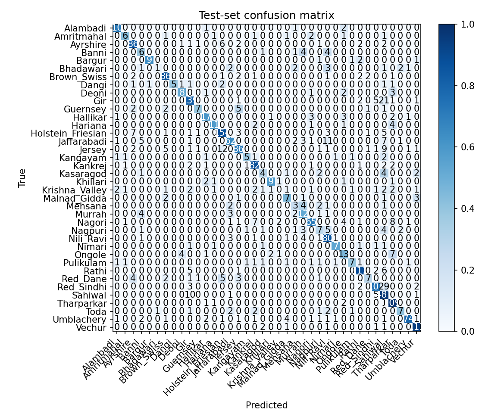
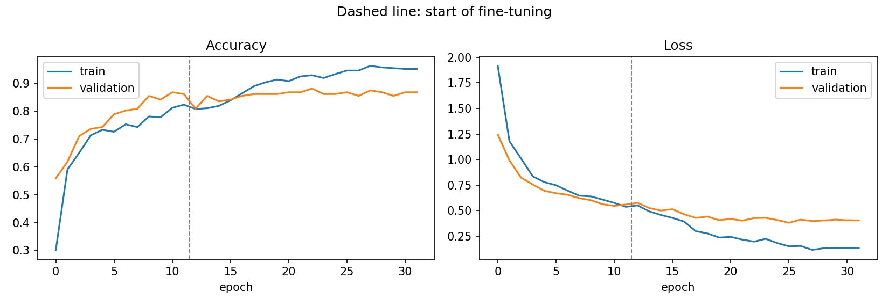

# 🐄 SAABI: Indian Cattle & Buffalo Breed Classifier

[](https://github.com/Viratgupta13/saabi-cattle-breed-classifier/actions/workflows/ci.yml)

Upload a photo, get the breed. SAABI identifies **8 Indian and exotic cattle/buffalo breeds** using
transfer learning on MobileNetV2, served through a Flask web UI and a JSON API.

> **Test accuracy: 83.6 %** (top-3: **96.1 %**, macro-F1: **0.84**) on 152 images held out from training and model selection.
> Also flags uncertain predictions and photos that aren't a supported breed (see *Knowing when it doesn't know*).

**[▶ Live demo](https://saabi-qhel.onrender.com/)** (free tier: the first load after idle can take ~30-60 s to wake up)

| Confusion matrix (test set) | Training curves |
|---|---|
|  |  |

## Breeds

Alambadi · Amritmahal · Dangi · Gir · Holstein Friesian · Jersey · Murrah · Sahiwal

## How it works

```
photo ─► augment (train only) ─► scale to [-1,1] ─► MobileNetV2 (ImageNet) ─► GAP ─► Dropout ─► Softmax(8)
```

- **Two-phase transfer learning:** train the classifier head with the backbone frozen, then fine-tune the top 40
  backbone layers at a low learning rate (BatchNorm kept frozen).
- **Preprocessing lives inside the model.** It takes raw RGB pixels, so training, evaluation and serving share a
  single code path and cannot drift apart (see *Engineering notes*).
- **Imbalance handling:** inverse-frequency class weights (Dangi has 82 images vs. 150 for the largest class).
- **Leak-free evaluation:** exact-duplicate images are removed before a stratified 70/15/15 train/val/test split.
  Validation drives early stopping and LR scheduling; the test set is touched only by `saabi.evaluate`.

## Results

| Metric (test, n=152) | Value |
|---|---|
| Top-1 accuracy | 83.6 % |
| Top-3 accuracy | 96.1 % |
| Macro F1 | 0.84 |

Strongest: Murrah (F1 0.96), Holstein Friesian (0.94), Alambadi (0.93).
Weakest: **Gir ↔ Sahiwal**: two visually similar zebu breeds, responsible for 12 of the 25 test errors.
Full per-class numbers are in `models/metrics.json`.

## Knowing when it doesn't know

A classifier that must pick one of 8 breeds will confidently mislabel a dog, a tractor or a landscape. SAABI adds two guards,
both fitted on the **validation split only**:

| Guard | Method | Result |
|---|---|---|
| **Calibration** | Temperature scaling of the softmax (T = 1.08) | Expected calibration error on test: **5.2 % → 3.9 %** |
| **Uncertain flag** | Reject when calibrated confidence is below a validation-chosen threshold | Answers 86 % of test images, with **88.5 %** accuracy on those (vs 83.6 % unfiltered) |
| **"Not a supported breed" flag** | Cosine distance from the image's backbone features to the nearest breed centroid; threshold keeps 95 % of validation images | Accepts 92.8 % of real test images; AUROC **0.995** separating cattle from non-cattle on a proxy set, vs **0.879** for a plain max-softmax threshold |

The non-cattle benchmark is a **proxy**: 834 random crops of 139 scenery/general photos (macOS wallpaper thumbnails and the
sample photos bundled with scikit-learn/matplotlib). All 834 were flagged. This is an easy case. It was *not* tested on
hard look-alikes (other animals, other cattle breeds), so treat it as a sanity check, not a guarantee.

The first attempt, a max-softmax threshold alone, accepted a temple photo as "Gir" at 83 % confidence, which is why the
feature-space check exists.

## Deployment efficiency (TFLite)

The trained Keras model is exported to TFLite (`python -m saabi.export`) and the web server runs on that, without TensorFlow:

| | Keras / TensorFlow | TFLite |
|---|---|---|
| Model size | 23.1 MB | **8.9 MB** |
| Server RAM (peak) | ~628 MB | **~75 MB** |
| Latency per image (CPU) | 43 ms | **11 ms** |
| Test accuracy | 83.55 % | 83.55 % (100 % prediction agreement, max probability diff 3.6e-6) |

Measured on an Apple-silicon laptop CPU, single image, after warm-up. The smaller footprint is what lets the demo run on a free 512 MB host.

## Engineering notes

- **Found and fixed a train/serve skew bug.** The original scripts trained on OpenCV (BGR) images, but the web
  app fed the model RGB images from PIL. On the same validation set, accuracy was 88.3 % with BGR input but only
  **68.8 %** with the RGB input the app actually sent. Moving normalisation into the model and using one RGB
  loader everywhere removes the failure mode.
- **Corrected an optimistic metric.** The original 88.3 % was measured on the same split used for early stopping and
  on a dataset containing 11 exact duplicates. Re-measured on a clean held-out test split, the honest figure is 83.6 %.
- Server-side validation: file type and size limits, corrupt-image handling, EXIF orientation correction,
  low-confidence warning in the UI.

## Run it

```bash
python -m venv venv && source venv/bin/activate
pip install -r requirements.txt

python app.py                       # http://127.0.0.1:5001
python -m saabi.predict photo.jpg   # CLI top-3
pytest                              # tests
```

API:

```bash
curl -F image=@photo.jpg http://127.0.0.1:5001/api/predict
# {"status":"ok","predictions":[{"breed":"Dangi","confidence":0.998}, ...],"info":{...}}
# status: "ok" | "uncertain" | "unsupported"
```

### Retrain / re-evaluate

Put images in `data/<BreedName>/*.jpg`, then:

```bash
python -m saabi.train
python -m saabi.evaluate   # writes models/metrics.json + assets/confusion_matrix.png
python -m saabi.calibrate  # fits temperature + rejection thresholds (re-run after every retrain)
python -m saabi.export     # exports the TFLite model used by the server and checks parity
```

### Docker

```bash
docker build -t saabi . && docker run -p 10000:10000 saabi   # http://localhost:10000
```

CI (`.github/workflows/ci.yml`) runs the tests and builds and smoke-tests the image on every push. See `DEPLOY.md` for free hosting on Render.

## Project layout

```
saabi/            config, data pipeline, model, train, evaluate, calibrate, export, scoring, predict
app.py            Flask app factory + /api/predict
templates/        web UI
tests/            data-split and API tests
models/           Keras + TFLite models, class names, calibration, metrics
```

## Limitations & next steps

- ~1,000 images total; per-class test sets are small (12–23 images), so per-class numbers have wide error bars.
- Gir vs. Sahiwal needs more and more varied data (or a higher-resolution / fine-grained model).
- Rejection of non-cattle images was validated on a proxy set only (see above); other animals and unseen breeds are untested.
- Next: Grad-CAM explanations, a stronger backbone with an ablation table, more Gir/Sahiwal data, Quantisation.

## Dataset

TODO: state the image source(s) and licence here. The raw dataset is not redistributed in this repo.
